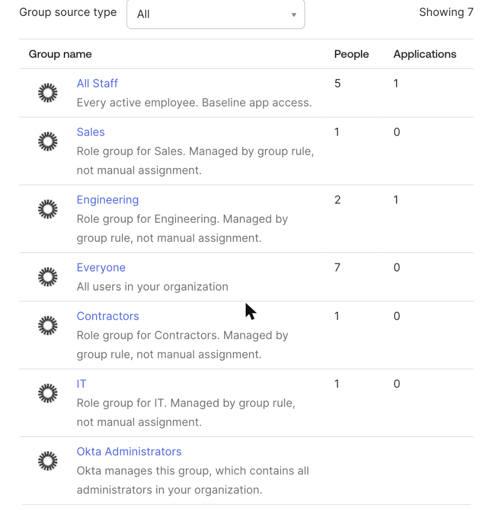
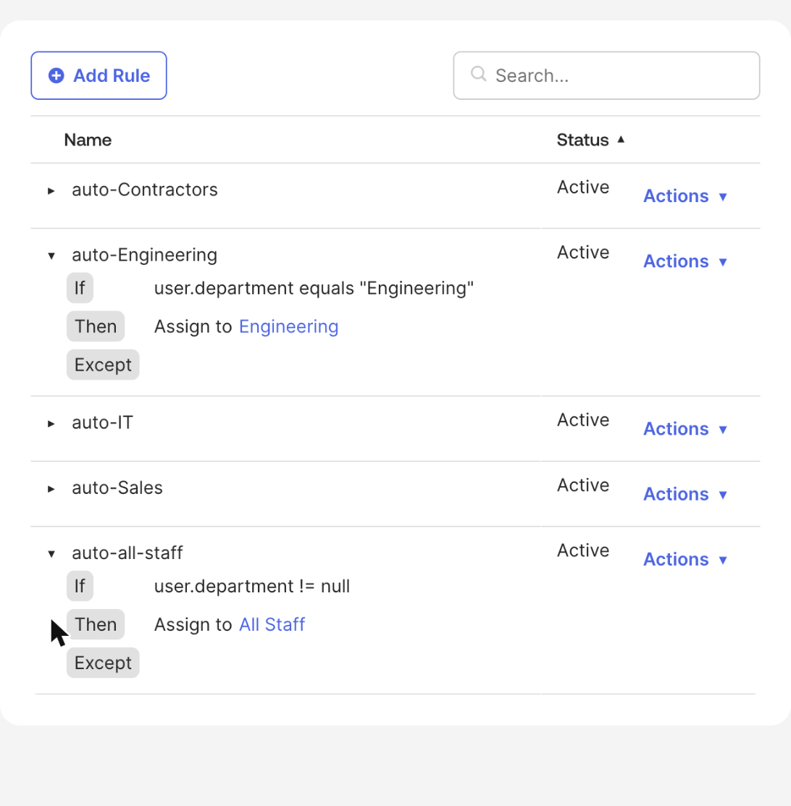
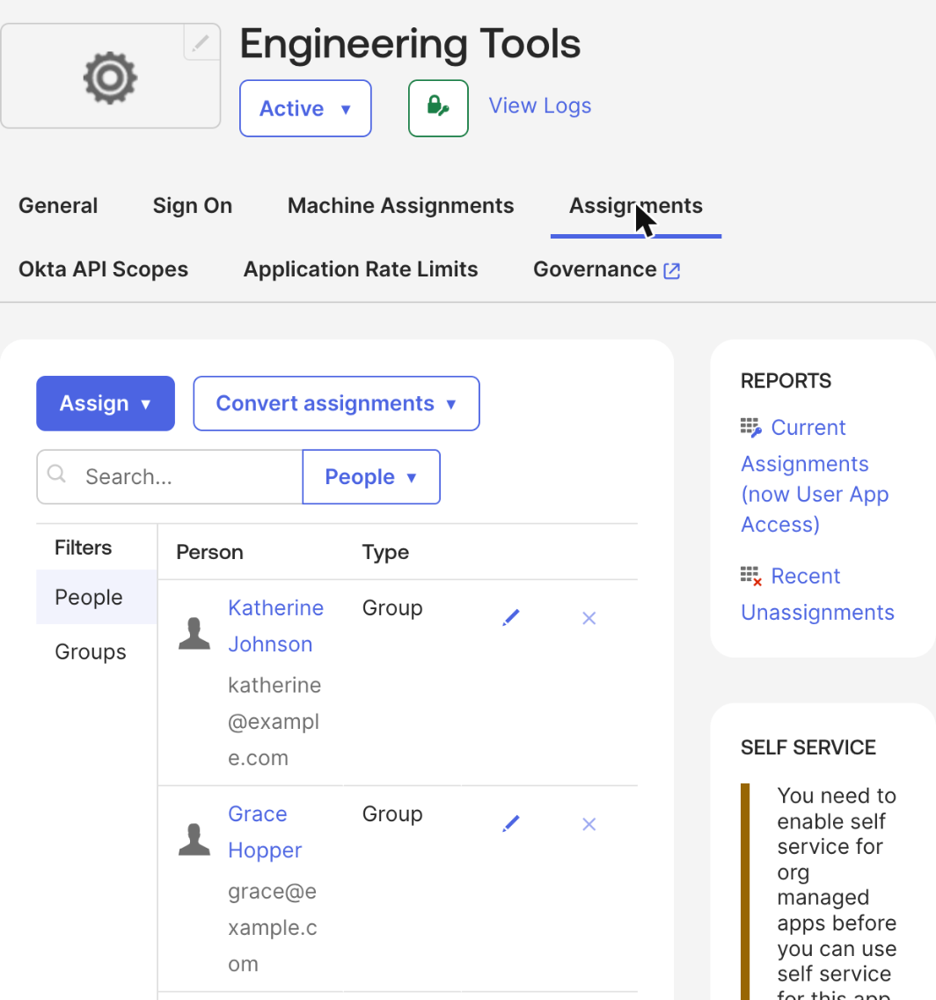
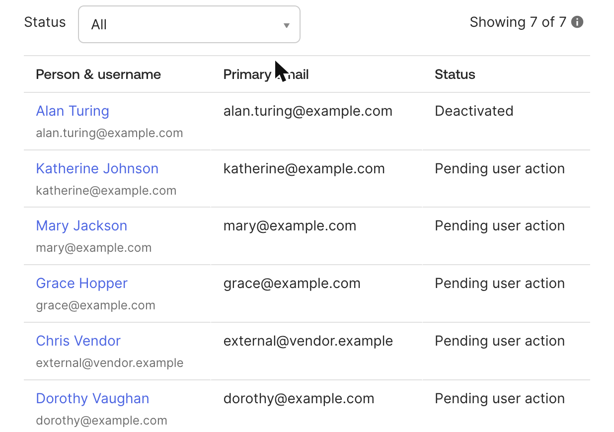
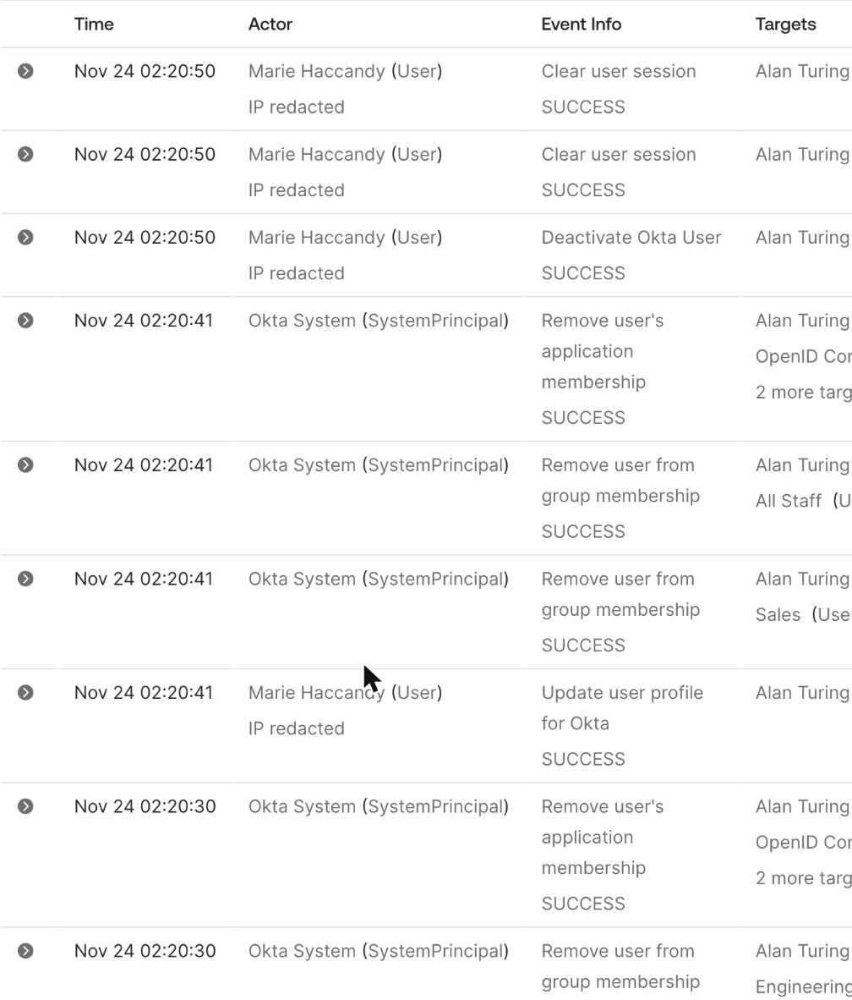

# Okta Workforce IAM Lab: Attribute-Driven RBAC and JML Automation

A workforce identity program for a small company, written as code and **deployed to a live Okta Integrator org**. Terraform builds the directory model, group rules, apps and policies (21 resources). Python scripts run the joiner-mover-leaver (JML) lifecycle and export an access review through the Okta API. The [evidence/](evidence/) folder and screenshots below come from the real run on 2026-11-24.

**Author:** Marie Haccandy, M.S. Cybersecurity Management · [LinkedIn](https://www.linkedin.com/in/marie-christine-haccandy-24b6b21ba) · [GitHub](https://github.com/mhacc001)

## The design in one rule

**No access is ever granted directly to a user.** A user's `department` attribute places them in groups through Okta group rules, and apps are assigned only to groups. As a result:

| Lifecycle event | What an admin does | What happens |
|---|---|---|
| Joiner | Create the user with a department | Group rules add the right groups. Apps follow the groups. |
| Mover | Change the department | Old groups and apps fall away, new ones attach. The script logs the difference. |
| Leaver | Deactivate | Every group and app is removed at once. The account is kept in DEPROVISIONED state for audit. |
| Access review | Run one script | Exports who has access to what as CSV. A query, not an investigation. |

Why rules instead of manual group assignment: manual assignments drift and rarely get removed. Rules re-evaluate every time the attribute changes, so the access model stays explicit and auditable. Full rationale: [docs/rbac-model.md](docs/rbac-model.md).

## What the code builds

| Area | Implementation | File |
|---|---|---|
| Groups | Engineering, Sales, IT, Contractors, plus All Staff | [terraform/main.tf](terraform/main.tf) |
| Group rules | `user.department == "<dept>"` per department; `user.department != null` for All Staff (rules only evaluate active users) | [terraform/main.tf](terraform/main.tf) |
| Apps | Two OIDC apps (Internal Portal for All Staff, Engineering Tools for Engineering), assigned to groups only | [terraform/main.tf](terraform/main.tf) |
| Authentication | MFA enrollment required for All Staff (password + Okta Verify) in Terraform; a stricter Contractor policy is designed in the policy doc | [terraform/main.tf](terraform/main.tf), [docs/mfa-policy.md](docs/mfa-policy.md) |
| Password policy | 12-character minimum, history of 8, lockout after 5 attempts, recovery by email only (no security questions) | [terraform/main.tf](terraform/main.tf) |
| JML automation | `onboard`, `move`, `offboard` commands that print groups and apps added or removed | [scripts/jml.py](scripts/jml.py) |
| Access review | CSV export of every user's status, groups and apps | [scripts/access_review.py](scripts/access_review.py) |

Step-by-step lifecycle flows: [docs/jml-flows.md](docs/jml-flows.md).

## Deployed and run (2026-11-24)

`terraform apply` created all 21 resources in the org. Then the lifecycle ran against a new test user, Alan Turing. Real output ([evidence/jml-run-2026-11-24.txt](evidence/jml-run-2026-11-24.txt)):

```
[joiner] created alan.turing@example.com department=Engineering
[joiner] groups now: ['All Staff', 'Engineering', 'Everyone']
[joiner] app access: ['Engineering Tools', 'Internal Portal']

[mover] alan.turing@example.com: Engineering -> Sales
[mover] groups added:   ['Sales']
[mover] groups removed: ['Engineering']
[mover] apps removed:   ['Engineering Tools']

[leaver] department cleared, then deactivated alan.turing@example.com
[leaver] groups removed:    ['All Staff', 'Sales']
[leaver] apps revoked:      ['Internal Portal']
[leaver] groups remaining:  ['Everyone']  (Everyone is built in and cannot be removed)
[leaver] apps remaining:    []
```

Okta's own System Log confirms that the access changes were made by the group rules, not by an admin. In [evidence/okta-system-log-alan-turing-2026-11-24.csv](evidence/okta-system-log-alan-turing-2026-11-24.csv), every group and app change on join, move and leave has the actor **Okta System**. The admin only created the user, changed one attribute, and deactivated the account. On the move, the Engineering group, the Sales group and the Engineering Tools app all changed in the same second.

The access review ([evidence/access-review-2026-11-24.csv](evidence/access-review-2026-11-24.csv)) shows every seed user holding exactly their department's access. Engineers have Engineering Tools and the Internal Portal. Everyone else, including the contractor, has only the Internal Portal.

### Screenshots from the live org

| | |
|---|---|
|  **Groups.** Every role group is rule-managed. After the leaver, All Staff holds only the 5 active employees. |  **Group rules.** The `department` attribute drives membership. |
|  **Engineering Tools.** Only the two engineers are assigned, and both through their group (Type: Group), never directly. |  **People.** The leaver is deactivated and kept for audit. The seed users are waiting on first sign-in. |
|  **System Log.** Okta System (the group rules) removes groups and apps. The admin only changed the attribute and deactivated the account. | |

### What broke on the first deploy, and the fixes

17 of 21 resources applied on the first run. The other 4 failed, and each failure taught something about how Okta works:

| Error | Cause | Fix |
|---|---|---|
| Group rule rejected `user.status == "ACTIVE"` | Okta group-rule expressions cannot read `user.status` | `user.department != null`. Rules only evaluate active users, so the meaning is the same. |
| MFA policy rejected email enrollment | In this org, email is a recovery-only authenticator | Require password + Okta Verify (knowledge + possession) |
| Password policy rejected security-question recovery | The Security Question authenticator is disabled, and it is weak anyway | `question_recovery = "INACTIVE"`, recovery by email only |
| App group assignment "ProfileMapping not found" | The app was not fully provisioned yet when Terraform assigned it | A re-apply succeeded with no code change |

Three other findings:
- **Deactivation does not remove group memberships in Okta.** The first run's screenshots showed deactivated test users still counted in All Staff and Sales. The leaver now clears the `department` attribute first, so the group rules drop every rule-managed group and app. Then it deactivates the account and verifies what is left (only the built-in Everyone group).
- The first version of the scripts read `/users/{id}/appLinks`. That lists only dashboard tiles, so it showed no apps for users who had never signed in. The scripts now query `/apps?filter=user.id eq "..."`, which returns actual assignments.
- An API token was pasted into a chat during setup. It was revoked and replaced immediately, and the replacement lives only in the gitignored `terraform.tfvars`.

## Deploy it yourself

Runs on a free Okta Integrator (developer) org.

```bash
# 1. Build the identity model
cd terraform
cp terraform.tfvars.example terraform.tfvars   # org name, base URL, API token
terraform init && terraform apply

# 2. Run the lifecycle
cd ../scripts
export OKTA_ORG_URL="https://dev-XXXXX.okta.com"
export OKTA_API_TOKEN="..."
python3 -m pip install -r requirements.txt

python3 jml.py onboard  --first Ada --last Lovelace --dept Engineering --email ada@example.com
python3 jml.py move     --email ada@example.com --new-dept Sales
python3 jml.py offboard --email ada@example.com
python3 access_review.py > access-review.csv
```

How to verify each step in the Okta admin console: [docs/RUNBOOK.md](docs/RUNBOOK.md).

## Related work

- [identity-governance-lab](https://github.com/mhacc001/identity-governance-lab): SCIM 2.0 provisioning, access certification campaigns, separation-of-duties checks and non-human identity audits
- [it-jml-toolkit](https://github.com/mhacc001/it-jml-toolkit): the same lifecycle in PowerShell against Microsoft Entra ID through Microsoft Graph

## Tools

Okta · Terraform (okta provider) · Python · Okta Management API · OIDC · MFA policy · RBAC · joiner-mover-leaver · access review
